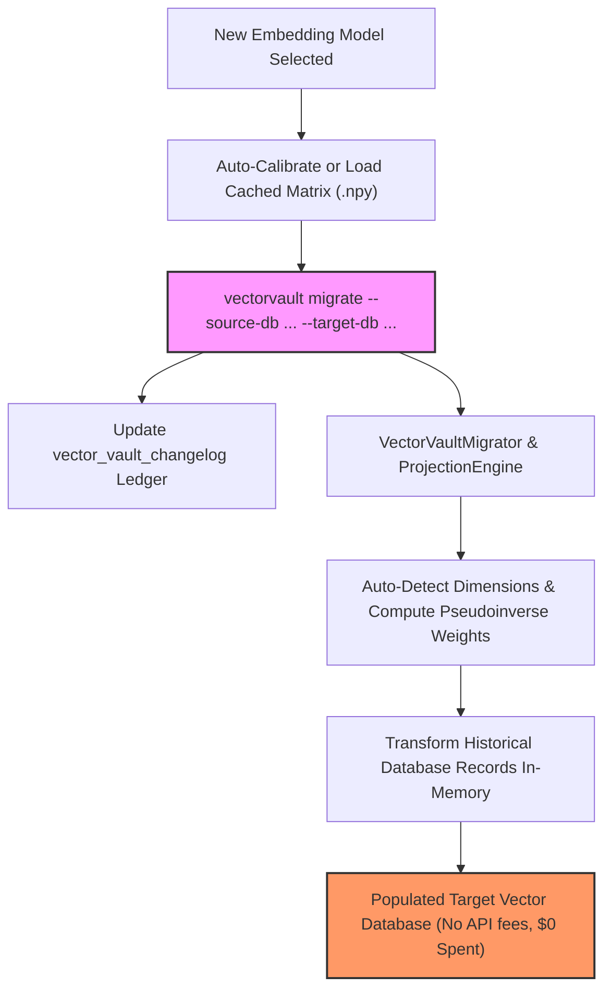

# VectorVault™

VectorVault is an open-source, vendor-agnostic DataOps framework that acts as the **Flyway / Liquibase for AI Vector Databases**. It brings strict version control, transactional lineage tracking, and algorithmic dimensional schema migration to AI data operations.

Instead of wiping your vector collections and spending thousands of dollars running heavy ETL re-embedding jobs through cloud APIs every time you upgrade your embedding models, VectorVault manages the lifecycle locally via deterministic database changelogs, auto-calibrated projection matrices, and high-performance linear algebra.

## Core Capabilities
- **Transactional Schema Control:** Tracks embedding shifts through an internal system ledger (`vector_vault_changelog`) to keep historical data lineage structurally organized.
- **Auto-Calibrated Dimensional Transformation:** Uses Ordinary Least Squares (OLS) linear projection matrices (`numpy`) with built-in anchor calibration and `.npy` disk caching to mathematically translate vectors across models (`384D` → `768D`) instantly without API fees or manual dimension configs.
- **Plug-and-Play Storage Migrator (`VectorVaultMigrator`):** Connects directly to source and empty target vector databases, auto-detects vector dimensions from binary storage, and migrates records in milliseconds.
- **Gateway Circuit Breaker:** Acts as a runtime firewall intercepting app queries, blocking mismatched dimensional requests before they cause database crashes.

## System Architecture



## Quick Start

### 1. Installation
Install the core engine along with database extras directly from your workspace:

```bash
pip install "vectorvault[all]"
```

*(For local development inside your cloned repository: `pip install -e .`)*

### 2. Verify Your Local Environment
Ensure the global CLI bindings are fully mapped to your environment:

```bash
vectorvault --help
```

### 3. Initialize the Metadata Tracking Ledger
Spin up the internal database schema tracking indexes cleanly:

```bash
vectorvault init
```

### 4. Run a Cross-Model Database Migration (CLI)
Migrate existing vectors from a legacy database directly into an empty destination database with automatic dimension detection:

```bash
vectorvault migrate \
  --source-model all-MiniLM-L6-v2 \
  --target-model all-mpnet-base-v2 \
  --source-db vault_data.db \
  --source-table legacy_storage_384d \
  --target-db new_company_vectors.db \
  --target-table migrated_storage
```

## Configuration Schema Example

Define your embedding model upgrades inside a standard JSON migration configuration file:

```json
{
  "version_id": "002",
  "description": "Upgrade from OpenAI text-embedding-3-small to local Llama3-Embedding",
  "source_model": "text-embedding-3-small",
  "target_model": "llama3-embedding"
}
```

Validate the file directly via the terminal execution check:

```bash
vectorvault validate -f migration.json
```

## Use the Python SDK

### Option A: End-to-End Database Migration (`VectorVaultMigrator`)
Connect directly to your source and target vector databases with zero manual dimension setup:

```python
from vectorvault.migrator import VectorVaultMigrator

migrator = VectorVaultMigrator(
    source_model_name="all-MiniLM-L6-v2",
    target_model_name="all-mpnet-base-v2"
)

result = migrator.migrate_sqlite(
    source_db_path="vault_data.db",
    source_table="legacy_storage_384d",
    target_db_path="new_company_vectors.db",
    target_table="migrated_storage"
)

print(f"✅ Migrated {result['count']} vectors ({result['source_dim']}D -> {result['target_dim']}D)")
```

### Option B: In-Process Math SDK (`VectorProjectionEngine`)
If you are running migrations straight inside your local data pipeline script, initialize the mathematical projections layer directly:

```python
from vectorvault.engine import VectorProjectionEngine

engine = VectorProjectionEngine()

# 1. Load cached projection matrix or auto-calibrate from built-in anchors
engine.get_or_train_matrix("all-MiniLM-L6-v2", "all-mpnet-base-v2", source_model, target_model)

# 2. Transform your full dataset instantly in-memory via matrix multiplication
migrated_vectors = engine.transform_vectors(production_old_vectors)
```

## Running the Verification Suite & Visual GUI

Ensure your changes align cleanly with development bounds by running the automated validation suite:

```bash
pytest -v
```

To generate a local cross-dimensional SQLite vector store (`384D` → `768D`) and inspect both storages visually in Datasette:

```bash
python tests/view_in_gui.py
datasette vault_data.db --load-extension=\$(python -c "import sqlite_vec; print(sqlite_vec.loadable_path())")
```
